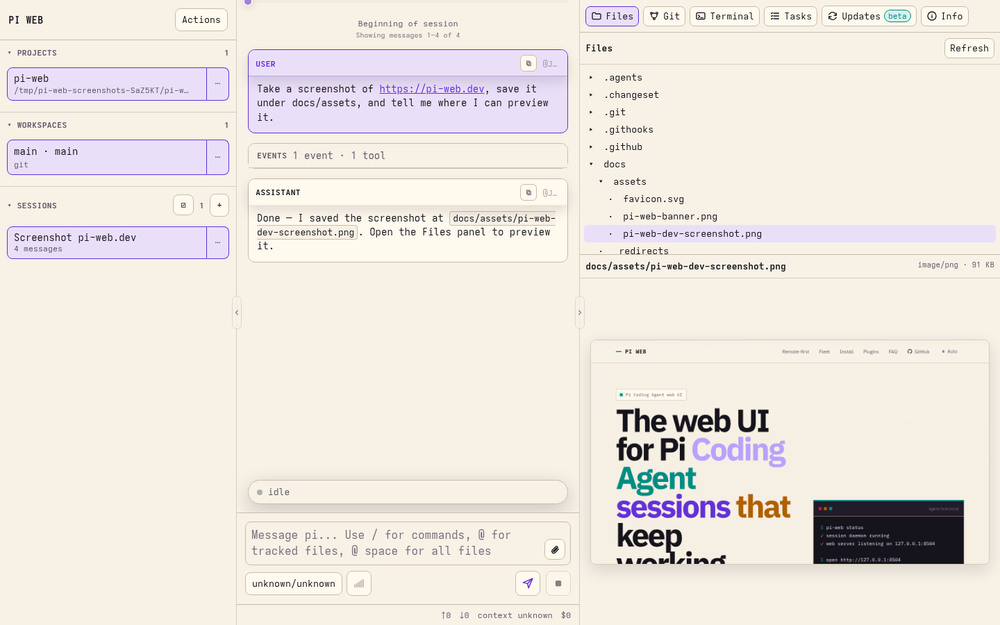

# PI STUDIO

[](https://github.com/Jobs-Zhang/pi-studio/actions/workflows/ci.yml)
[](LICENSE)

PI STUDIO is a lightweight, multi-platform coding workspace for [Pi Coding Agent](https://github.com/earendil-works/pi/tree/main/packages/coding-agent). Manage projects, AI sessions, files, and terminals across Web, Windows Desktop, and Android, on your own machines or remote servers.

Lightweight and performant first: concise interfaces, direct workflows, and responsive interaction. Features serve core coding needs without feature overload or unnecessary technical complexity.

## Capabilities

- Organize work as machine → project → workspace → session, with Git worktree support.
- Keep sessions running in a separate daemon across browser disconnects and Web/API restarts.
- Manage conversations, files, terminals, and plugins, including on trusted remote machines.
- Connect from Windows or Android using direct connections or SSH tunnels, with a shared connection page.



## Project Status

The project currently supports running from source and building clients yourself. npm publishing, a standalone website, and official client downloads are not configured. Reserved configuration and installation instructions do not imply an available release channel.

- **Web:** run from source.
- **Windows:** build the `PI Studio Setup.exe` installer.
- **Android:** build a debug APK; signed release distribution is not configured.

## Run from Source

Requires Node.js 22.19+ (24 recommended), npm, Git, and a Pi Coding Agent 1.x environment with models and credentials configured.

```bash
git clone https://github.com/Jobs-Zhang/pi-studio.git
cd pi-studio
npm ci
npm run dev
```

Repository access is required while the repository is private. Open the Vite URL printed in the terminal (default port `8505`). The Web/API defaults to port `8504`. Use the server's reachable address for access from other devices and restrict network access appropriately.

`npm run dev` starts a development process group including sessiond. Stopping it interrupts that group's sessions and terminals. To keep sessiond separate from UI/API development, run each command in its own terminal:

```bash
npm run start:sessiond
npm run dev:web
npm run dev:client
```

Do not start a second daemon against an existing instance's data directory. Independent instances need separate data directories, sockets, and ports; see [managed data directories](docs/config.md#managed-data-directory).

## Basic Workflow

1. Add a project on the selected machine.
2. Choose a workspace or create a Git worktree.
3. Create or explicitly select a session and send a task.
4. Continue working from the browser or a connected client.

Windows and Android are connection clients. The Gateway normally serves the application UI; these clients do not bundle a complete offline server.

## Development and Verification

This project does not write automated tests. Verify behavior through real functional checks, supported by manual review and static analysis.

```bash
npm run verify
git diff --check
```

See [development guidelines](AGENTS.md) and [development and delivery checks](docs/development-checks.md).

## Documentation

- [Windows client](desktop/README.md)
- [Android client](android/README.md)
- [Configuration](docs/config.md)
- [Plugins and Pi packages](docs/plugins.md)
- [Docker (experimental)](docker/README.md)
- [Installation and deployment](docs/install.html): an HTML page best viewed through a static server; use the source setup above for the current development version.

## Security Model

PI STUDIO assumes trusted users, repositories, and server paths. It is not a sandbox or a multi-tenant platform. Do not expose it directly to the public internet; use a trusted network, VPN, SSH tunnel, or authenticated reverse proxy.

## Acknowledgments and License

Maintained by [Jobs Zhang](https://github.com/Jobs-Zhang). Thanks to Federico Jaramillo Martinez and the [PI WEB](https://github.com/jmfederico/pi-web) contributors for the upstream work.

Licensed under MIT. The original author's copyright notice is retained; Jobs Zhang holds copyright in their modifications and additions. See [LICENSE](LICENSE) for the full terms.
